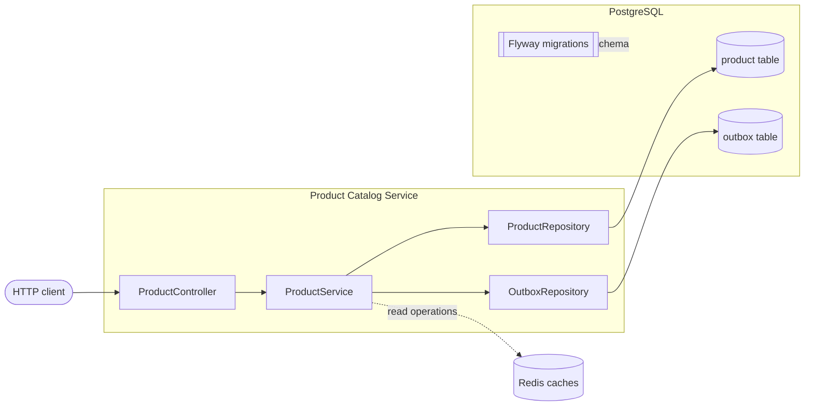
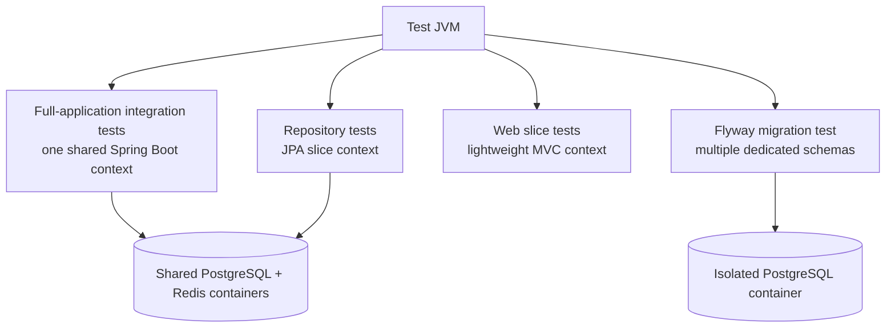
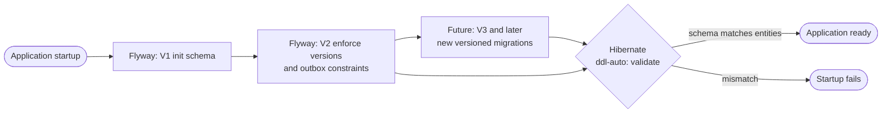
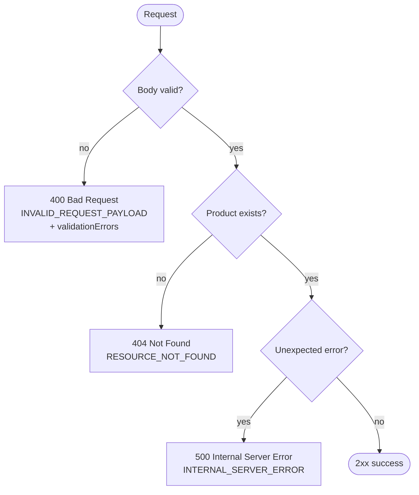
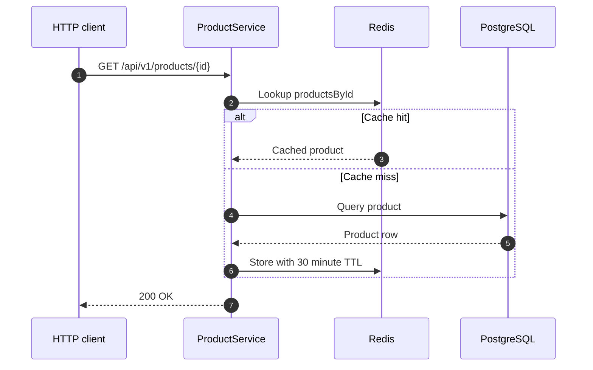
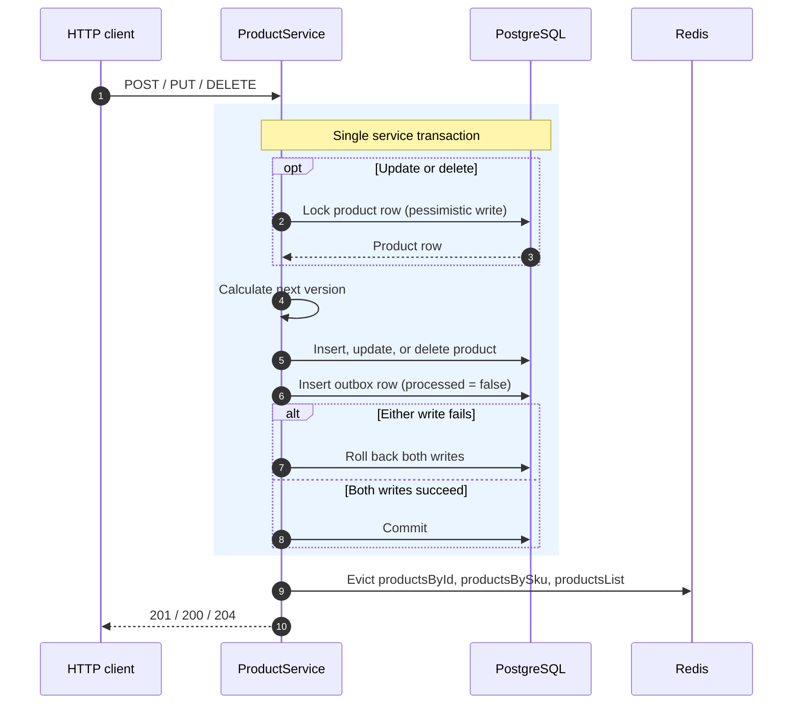
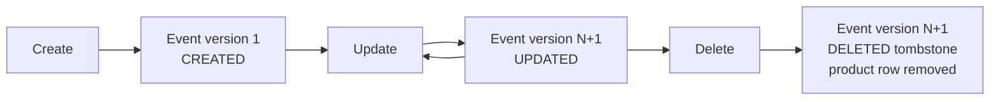
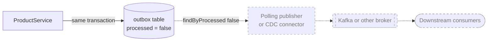
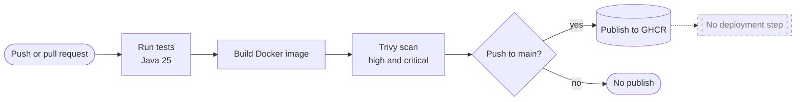

# Product Catalog Service

A Java 25 / Spring Boot REST API for managing products, persisted in PostgreSQL. The application uses Flyway for schema evolution, Redis-backed Spring caching for reads, and a transactional outbox table for product lifecycle event intents.

The outbox records are persisted but are **not currently published** to Kafka or another broker. A separate polling publisher or CDC connector and end-to-end delivery verification are required before the service provides downstream event delivery.

## Architecture



`ProductController` maps HTTP requests to service operations and DTOs. `ProductService` owns transaction boundaries, product version changes, cache eviction, and atomic persistence of product changes with outbox records. PostgreSQL is the source of truth; Redis is a cache, not a persistence substitute. No authentication or authorization implementation is included.

Cross-repository architecture decisions are tracked in the canonical [Product Platform ADR index](https://github.com/Jahrough/ai-native-engineering/blob/main/docs/architecture/adr/README.md). Those records are proposals unless explicit approval is recorded; they do not imply implementation or deployment.

## Technology

- Java 25 and Spring Boot 4.1.2
- Spring MVC, Spring Data JPA, Jakarta Bean Validation, and Flyway
- PostgreSQL; Redis with Spring Cache
- SpringDoc OpenAPI / Swagger UI
- MapStruct and Lombok
- JUnit 5, Spring Boot Test, MockMvc, Mockito, H2, and Testcontainers
- Gradle Kotlin DSL and JaCoCo
- Docker and GitHub Actions

Actuator, Prometheus metrics, Micrometer tracing, and logging dependencies are present. Their presence does not mean an external metrics scraper or trace backend is running; see [Observability](#observability).

## Project layout

```text
src/main/java/dev/jahlopez/productcatalog/
├── config/       # JPA auditing, OpenAPI, Redis caches
├── controller/   # REST endpoints
├── dto/          # API request and response types
├── event/        # Product lifecycle event payload
├── exception/    # Not-found and API exception handling
├── mapper/       # MapStruct DTO/entity mappings
├── model/        # JPA product and outbox entities
├── repository/   # Spring Data repositories
└── service/      # Business operations and transaction boundaries
src/main/resources/
├── application.yml
└── db/migration/ # Flyway V1 and V2 migrations
src/test/java/    # Controller, unit, repository, and integration tests
```

## Prerequisites and configuration

- JDK 25
- PostgreSQL for local runs
- Redis for cache-backed application operations
- Docker for Testcontainers integration tests and Docker image builds

`src/main/resources/application.yml` reads the following environment variables:

| Variable                           | Default                           | Purpose                                           |
| ---------------------------------- | --------------------------------- | ------------------------------------------------- |
| `SERVER_PORT`                      | `8080`                            | HTTP port                                         |
| `DB_HOST`                          | `localhost`                       | PostgreSQL host                                   |
| `DB_PORT`                          | `5432`                            | PostgreSQL port                                   |
| `DB_NAME`                          | `productdb`                       | Database name                                     |
| `DB_USER`                          | `postgres`                        | Database user                                     |
| `DB_PASSWORD`                      | **Required**                      | Database password; no default is configured       |
| `DB_POOL_MAX_SIZE`                 | `10`                              | Hikari maximum pool size                          |
| `DB_POOL_MIN_IDLE`                 | `2`                               | Hikari minimum idle connections                   |
| `DB_POOL_MAX_LIFETIME`             | `1500000`                         | Maximum connection lifetime in milliseconds       |
| `DB_POOL_KEEPALIVE_TIME`           | `300000`                          | Connection keepalive interval in milliseconds     |
| `REDIS_HOST`                       | `localhost`                       | Redis host                                        |
| `REDIS_PORT`                       | `6379`                            | Redis port                                        |
| `FLYWAY_BASELINE_ON_MIGRATE`       | `false`                           | Whether Flyway baselines an existing schema       |
| `SWAGGER_ENABLED`                  | `false`                           | Enables the OpenAPI JSON and Swagger UI endpoints |
| `OTEL_TRACES_SAMPLING_PROBABILITY` | `0.1`                             | Configured trace sampling probability             |
| `OTEL_EXPORTER_OTLP_ENDPOINT`      | `http://localhost:4318/v1/traces` | Configured OTLP endpoint                          |

Use environment variables or a secret manager for credentials. Do not use sample credentials in shared environments. `FLYWAY_BASELINE_ON_MIGRATE` is intended only for deliberate adoption of Flyway against an existing database; it is not needed for a fresh database.

Hibernate runs with `ddl-auto: validate`; Flyway owns schema creation and changes. Redis host/port settings configure the connection used by the named product caches.

## Run locally

Create the `productdb` PostgreSQL database, start Redis, set `DB_PASSWORD`, then run:

```bash
export DB_PASSWORD='your-local-password'
./gradlew bootRun
```

Run the test suite with Java 25:

```bash
JAVA_HOME=$(/usr/libexec/java_home -v 25) ./gradlew clean test --no-configuration-cache
```

The project also supports focused tests, for example:

```bash
./gradlew test --tests "dev.jahlopez.productcatalog.controller.ProductControllerTest"
./gradlew test --tests "dev.jahlopez.productcatalog.service.ProductServiceTest"
./gradlew test --tests "dev.jahlopez.productcatalog.integration.FlywayMigrationIntegrationTest"
```

The integration and repository-slice tests use a shared PostgreSQL and Redis container pair for the test JVM. Full-application integration tests share one Spring Boot test context configuration; repository tests use a separate JPA slice context, and web slice tests use their own lightweight MVC context. The Flyway migration test retains an isolated PostgreSQL container because it creates and migrates multiple dedicated schemas. Testcontainers tests require a working Docker environment. Review the Gradle test report for executed, failed, and skipped tests; a successful Gradle task alone does not establish that Docker-backed tests ran.



Spring test context cache statistics are enabled at DEBUG in `src/test/resources/logback-test.xml` to help verify context reuse. The Gradle test task loads Mockito's Java agent at startup to avoid dynamic agent attachment and disables class-data sharing for that test JVM because Mockito instrumentation modifies the bootstrap class path. These settings apply to test execution only.

JaCoCo reports are written to `build/reports/jacoco/test/html/` and `build/reports/jacoco/test/jacocoTestReport.xml`. No coverage threshold is configured.

## Database migrations

Flyway applies migrations in version order from `src/main/resources/db/migration/`.

- **V1 (`V1__init_schema.sql`) is the initial schema migration and is immutable once applied.** Do not edit an applied migration; checksums are part of Flyway's migration history.
- **V2 (`V2__enforce_product_versions_and_outbox_constraints.sql`) is a forward migration.** It shifts legacy product and outbox event versions from zero-based to one-based together, changes product versions to integers, and adds positive-version and payload constraints. It rejects malformed or out-of-range legacy data rather than silently accepting it.
- Future schema changes should be added as new versioned migrations (for example V3), not made by changing V1 or an already-applied V2.

For a fresh database, Flyway runs V1 and V2. Hibernate then validates the resulting schema against the JPA entities.



## API

All product routes use `/api/v1/products`. Successful responses use JSON except for `DELETE`, which returns no content.

| Method   | Path                         |          Success | Behavior                                                   |
| -------- | ---------------------------- | ---------------: | ---------------------------------------------------------- |
| `POST`   | `/api/v1/products`           |    `201 Created` | Create a product                                           |
| `PUT`    | `/api/v1/products/{id}`      |         `200 OK` | Replace product fields and increment its aggregate version |
| `GET`    | `/api/v1/products`           |         `200 OK` | List all products                                          |
| `GET`    | `/api/v1/products/{id}`      |         `200 OK` | Retrieve by database ID                                    |
| `GET`    | `/api/v1/products/sku/{sku}` |         `200 OK` | Retrieve by SKU                                            |
| `DELETE` | `/api/v1/products/{id}`      | `204 No Content` | Delete by database ID and record a deletion event          |

`POST` and `PUT` request bodies contain `sku`, `name`, `price`, and `stockQuantity`; `description` is optional. SKU and name must not be blank, price must be greater than zero, and stock quantity must be zero or greater. Missing products return `404 Not Found`. Bean validation errors return `400 Bad Request`. Unexpected errors return `500 Internal Server Error` with a generic client-facing message. Duplicate SKU violations are not currently translated into a dedicated `409 Conflict` response.

Example request:

```json
{
  "sku": "PROD-HUB-001",
  "name": "USB-C Multiport Hub",
  "description": "Aluminum 7-in-1 adapter",
  "price": 49.99,
  "stockQuantity": 150
}
```

The standard error response contains `status`, `errorCode`, `message`, `path`, and `timestamp`; validation errors also include `validationErrors` with field names and messages. Error codes currently include `RESOURCE_NOT_FOUND`, `INVALID_REQUEST_PAYLOAD`, and `INTERNAL_SERVER_ERROR`.



All three named Redis caches (`productsById`, `productsBySku`, and `productsList`) are evicted after writes. Reads are cacheable with configured TTLs of 30 minutes for individual products and 15 minutes for lists.



## OpenAPI

OpenAPI endpoints are disabled by default. Enable them when starting the application with:

```bash
SWAGGER_ENABLED=true ./gradlew bootRun
```

Then open `http://localhost:8080/swagger-ui.html` or `http://localhost:8080/v3/api-docs`. The application does not implement bearer-token security; these routes are not protected by an authentication layer.

## Transactional outbox

For create, update, and delete operations, the product mutation and its outbox row are written within the same service transaction. A failure to persist either operation rolls back the transaction. Updates and deletes acquire a pessimistic write lock for the product row before calculating the next event version, serializing concurrent changes to the same product.



The `outbox` row contains `eventId`, `aggregateType` (`product`), `aggregateId` (product ID as a string), `eventType` (`ProductCreated`, `ProductUpdated`, or `ProductDeleted`), JSON `payload`, `schemaVersion`, `createdAt`, and `processed`. `processed` defaults to `false`.

The version-1 JSON payload represents `ProductEvent` and includes `schemaVersion`, `eventId`, `version`, `productId`, `sku`, `name`, `description`, `price`, `stockQuantity`, `eventType`, and `timestamp`. The payload's `eventType` is the enum value `CREATED`, `UPDATED`, or `DELETED`. Product creation starts at version 1; each update increments it by one. A delete event uses the next version as a tombstone, while the product row itself is removed.



`OutboxRepository.findByProcessed(false)` supports a future polling publisher. No publisher, Kafka client, or CDC connector is configured in this repository, so the outbox currently provides durable event intent only—not delivery, retries, deduplication, or ordering guarantees for consumers.

The diagram below separates what exists today (solid) from what is still required (dashed).



## Observability

The configured Actuator web endpoints include health, info, and Prometheus. With the application running:

- Health: `http://localhost:8080/actuator/health`
- Liveness: `http://localhost:8080/actuator/health/liveness`
- Readiness: `http://localhost:8080/actuator/health/readiness`
- Prometheus: `http://localhost:8080/actuator/prometheus`

`/actuator/metrics` is not included in the configured web exposure list. Prometheus metrics are only useful to external monitoring when a scraper is configured. Tracing libraries and OTLP-related properties exist, but this repository does not verify trace export to a collector.

```mermaid
flowchart LR
    app[Product Catalog Service]
    app --> act[Actuator endpoints<br/>health, liveness, readiness, prometheus]
    app -. OTLP traces, sampling 0.1 .-> otlp[[OTLP collector]]
    act -. requires a configured scraper .-> prom[[Prometheus]]

    classDef external stroke-dasharray: 5 5,stroke:#999,color:#777
    class otlp,prom external
```

Dashed components are not provided or verified by this repository.

## Docker and CI

Build the image from the repository root:

```bash
docker build -t product-catalog:local .
```

The multi-stage Dockerfile builds with a Java 25 JDK and runs on a Java 25 JRE as a non-root user on port 8080. The image build skips tests; run the Gradle test/build command separately. The container requires reachable PostgreSQL and Redis services. For example, when those services are running on the host under Docker Desktop:

```bash
docker run --rm --name product-catalog \
  -p 8080:8080 \
  -e DB_HOST=host.docker.internal \
  -e DB_NAME=productdb \
  -e DB_USER=postgres \
  -e DB_PASSWORD='your-local-password' \
  -e REDIS_HOST=host.docker.internal \
  product-catalog:local
```

The GitHub Actions workflow runs tests with Java 25, builds and scans the image with Trivy for high and critical findings, and publishes to GHCR on pushes to `main`. The workflow publishes a container image; it does not deploy the application to a hosting platform.


